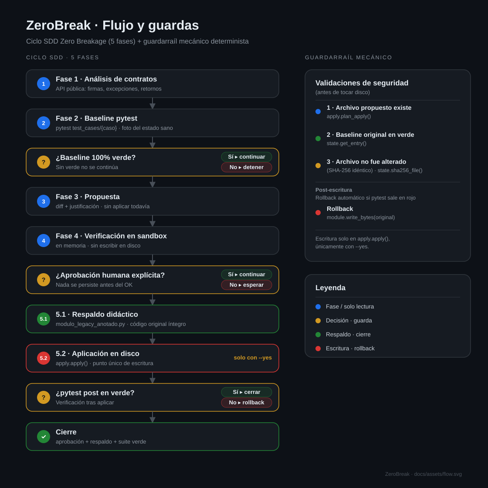

# Flujo completo de ZeroBreak

El diagrama resume el ciclo de refactorización segura en **dos capas**:

- **Capa conceptual (SDD)** — columna izquierda: el proceso de 5 fases que sigue
  el agente/humano, con sus puertas de decisión (baseline rojo, falta de
  aprobación, `pytest` post rojo).
- **Capa mecánica (CLI)** — columna derecha: las validaciones de seguridad del
  guardarraíl `zerobreak apply`, el punto único de escritura y el rollback.

> La imagen es un **SVG vectorial** ([`docs/assets/flow.svg`](assets/flow.svg)):
> se ve nítida a cualquier zoom y en cualquier tamaño de pantalla.

## Leyenda de colores

| Color | Significado |
|---|---|
| 🔵 Azul | Fase / solo lectura |
| 🟡 Amarillo | Decisión · guarda |
| 🟢 Verde | Respaldo · cierre |
| 🔴 Rojo | Escritura en disco · rollback |

## Cómo leerlo

1. **Columna izquierda — el ciclo SDD:** cada tarjeta es una fase. Las tarjetas
   amarillas son decisiones y muestran sus **dos salidas** en chips: verde
   `Sí ▸ continuar` y rojo `No ▸ detener / esperar / rollback`.
2. **Columna derecha — el guardarraíl:** las cuatro validaciones que se comprueban
   **antes** de escribir, más el rollback, que actúa **después** (si `pytest`
   sale en rojo).
3. **Punto único de escritura:** la tarjeta roja `5.2 · Aplicación en disco`
   (`apply.apply()`), y solo con `--yes`.

## Sincronización con la implementación

Cada fase y validación del diagrama se corresponde con una pieza real del
paquete (detalle línea a línea en [`architecture.md`](architecture.md)):

| Elemento del diagrama | Pieza en el código |
|---|---|
| Fase 2 · Baseline pytest | `runner.run_pytest` + `state.record_baseline` |
| Validación 1 · Archivo propuesto existe | `apply.plan_apply` (`source.is_file()`) |
| Validación 2 · Baseline original en verde | `state.get_entry` (`baseline_ok`) |
| Validación 3 · Archivo no alterado (SHA-256) | `state.sha256_file` |
| Validación 4 · Contrato público intacto (AST) | `contracts.check_contracts` (`ast.parse`) |
| Aprobación humana · `Sí ▸ continuar` | Confirmación interactiva en `run` o `--yes` en `apply` |
| 5.1 · Respaldo didáctico | `backup.ensure_backup` |
| 5.2 · Aplicación en disco (atómica) | `apply.apply` → `_atomic_write_bytes` (`os.replace`) |
| Post-escritura · Rollback | `_atomic_write_bytes(module, original)` |
| Cierre | `state.record_baseline` (nuevos hashes) |

## Garantías que codifica el diagrama

- **Decisiones sin efectos secundarios:** las cuatro validaciones de `plan_apply`
  (archivo propuesto existe; baseline verde vía `state.get_entry`; SHA-256
  coincidente vía `state.sha256_file`; contratos públicos intactos vía
  `contracts.check_contracts`) se evalúan **antes** de tocar disco.
- **Punto único de escritura atómica:** solo `apply.apply()` escribe mediante
  `_atomic_write_bytes` (`os.replace`), y solo tras confirmación o `--yes`;
  sin él, previsualiza el diff y devuelve `0` sin modificar nada.
- **Respaldo obligatorio y previo:** `backup.ensure_backup` crea
  `modulo_legacy_anotado.py` (idempotente) antes de sobrescribir (5.1 antes de 5.2).
- **Rollback automático:** si `runner.run_pytest` (subproceso `python -m pytest -q`)
  sale en rojo, se restauran los bytes originales de forma atómica con `_atomic_write_bytes(module, original)`.
- **Baseline siempre verde:** `state.record_baseline` solo se invoca en verde, y el
  respaldo didáctico queda aislado de pytest por `collect_ignore_glob` en `conftest.py`.

Para el detalle línea a línea de cada módulo, ver [`architecture.md`](architecture.md).
